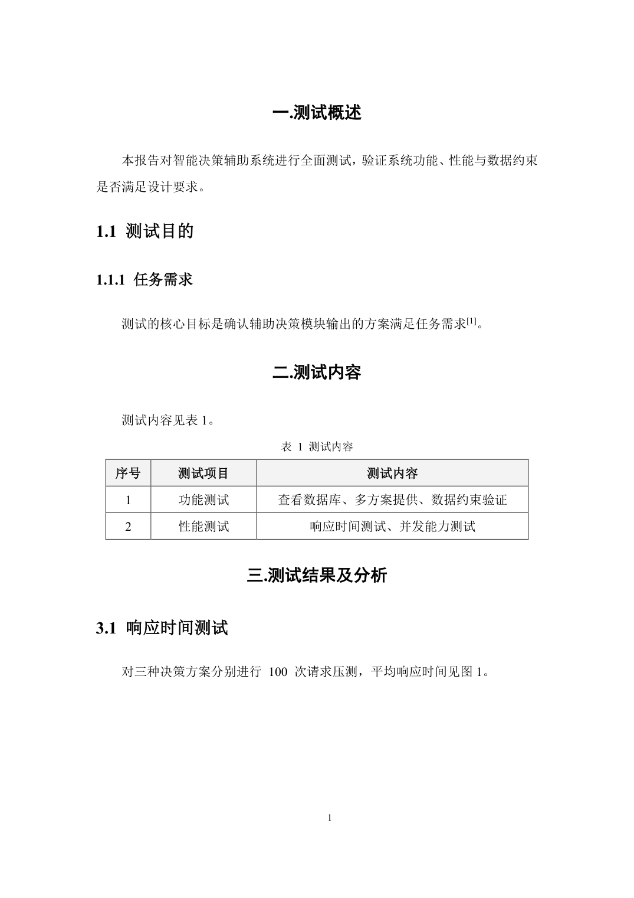

# lsh-project-report-template-word

**ZCode 技能：按固定格式模板一键生成 Word 项目报告**
A ZCode skill that generates Word (.docx) project reports in a fixed corporate template.

把报告内容交给 agent，它按本技能内固化的《项目报告模板》格式规范产出 `.docx`——
样式、分节、页码、目录、题注编号全部继承自模板底版，不是"照着规范重新排版"，
因此格式保真是结构性的。

## 生成效果

| 封面 | 正文 |
|---|---|
|  |  |

## 格式特性

- **正文**：宋体 + Times New Roman 小四（12pt），1.5 倍行距，两端对齐，首行缩进 2 字符
- **标题**：一级黑体 16pt 加粗居中（`一.` `二.`），二级宋体 16pt（`1.1`），三级宋体 14pt（`1.1.1`）
- **页面**：A4，上下 2.54cm / 左右 3.18cm；封面无页码 → 目录/图表目录大写罗马页码（I、II）→ 正文阿拉伯页码从 1 重新开始
- **目录**：`TOC \o "1-3"` 域 + 图目录 / 表目录（`TOC \c "图"` / `TOC \c "表"`），打开文档自动刷新
- **题注**：宋体 10.5pt 居中，SEQ 域自动编号，表题注在表上方、图题注在图下方
- **表格**：数据表 = 0.5pt 全框线 + 浅灰表头（F3F3F3）；框架/流程表 = 三线式（上下 1.5pt 粗线、无左右外框）
- **参考文献**：GB/T 7714 顺序编码制，正文上标 `[1]`，文末悬挂缩进列表

完整格式规范（样式 ID、原始 XML 值、域代码）见
[references/format-spec.md](references/format-spec.md)。

## 安装

要求：Python 3.9+（生成时需要 `python-docx`，技能触发后 agent 会自动检查/安装）；
生成的文档用 Microsoft Word 或 WPS 打开。

```bash
# 方式一：安装到用户级技能目录（所有工作区可用）
git clone https://github.com/Nofearli/lsh-project-report-template-word.git
cd lsh-project-report-template-word && ./install.sh        # Windows: powershell -File install.ps1

# 方式二：仅当前工作区可用
# 把整个文件夹复制到 <工作区>/.zcode/skills/lsh-project-report-template-word
```

## 使用

在 ZCode 里直接说：

> 按项目报告模板写一份 XX 系统测试报告，包含测试内容表格和响应时间对比图

技能会写出驱动脚本调用 `scripts/build_report.py` 生成 docx。也可以手动编写：

```python
import sys
sys.path.insert(0, r"<技能目录>/scripts")
from build_report import Report, cn_num

r = Report()
r.set_cover(title="智能决策辅助系统测试报告", date="2026年 10月")
r.h1(f"{cn_num(1)}.测试概述")            # 一.测试概述
r.para("本报告对……进行全面测试。")         # 首行缩进/1.5倍行距/两端对齐自动处理
r.h2("1.1 测试目的")
r.para_rich(["……满足任务需求", ("[1]", {"sup": True}), "。"])   # 上标引用
r.table(caption="测试内容", headers=["序号", "项目", "内容"],
        rows=[["1", "功能测试", "……"]], widths_cm=[1.5, 3.5, 9.0])
r.figure("fig1.png", "各方案响应时间对比", width_cm=11.5)        # 图 1 题注自动编号
r.references(["张三. 某系统设计[J]. 系统工程与电子技术, 2024, 46(2): 512-520."])
r.save("报告.docx")
```

打开生成的文档时目录与编号会自动刷新；若未刷新，全选按 `F9` 或右键"更新域"。

## 目录结构

```
lsh-project-report-template-word/
├── SKILL.md                  # 技能入口：触发条件、工作流、API 速查
├── references/
│   └── format-spec.md        # 完整格式规范（样式/分节/域代码）
├── scripts/
│   ├── build_report.py       # 报告生成器（核心）
│   └── make_template_base.py # 从原始模板重建底版
├── assets/
│   ├── template-base.docx    # 底版：封面+目录骨架+三段分节+全部样式
│   └── 项目报告模板.docx      # 原始模板（格式对照基准）
├── docs/                     # README 效果图
├── install.sh / install.ps1  # 安装到 ~/.zcode/skills
└── LICENSE
```

## 适配自己的模板

fork 后把 `assets/项目报告模板.docx` 换成你自己的模板，调整 `make_template_base.py`
中的结构索引并重跑，再按需修改 `build_report.py` 的样式 ID 与 `SKILL.md` 的格式说明即可。

## License

[MIT](LICENSE) © 2026 Shawn Lee
